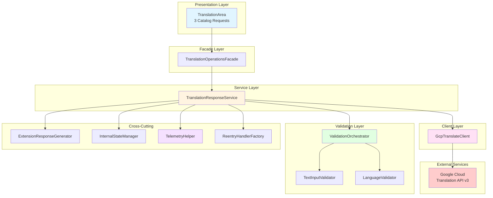
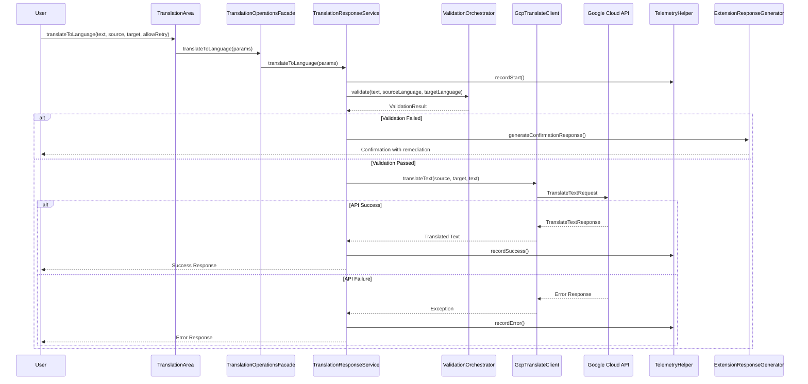
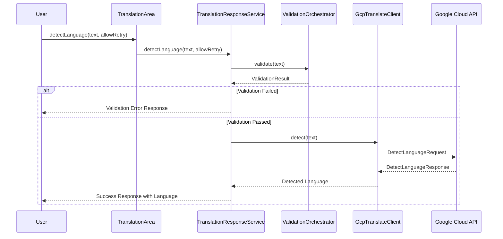
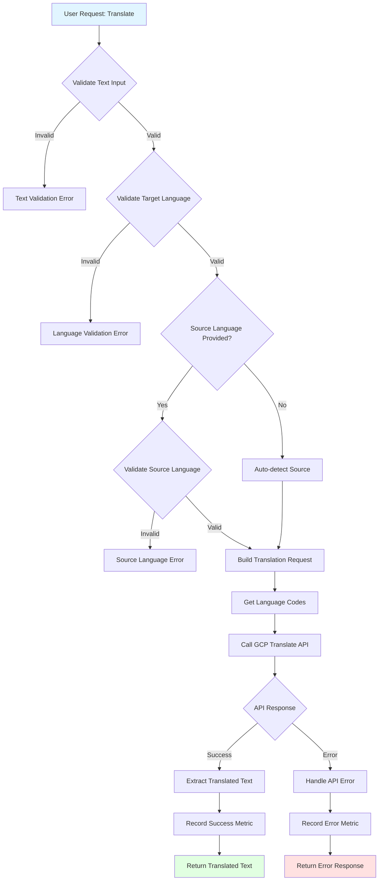
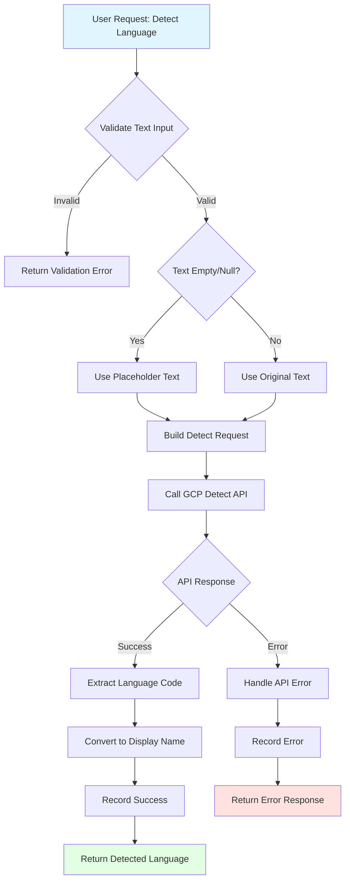
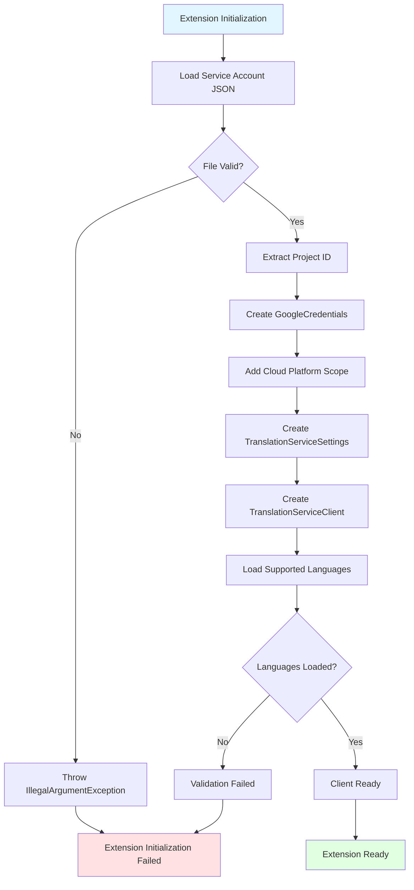
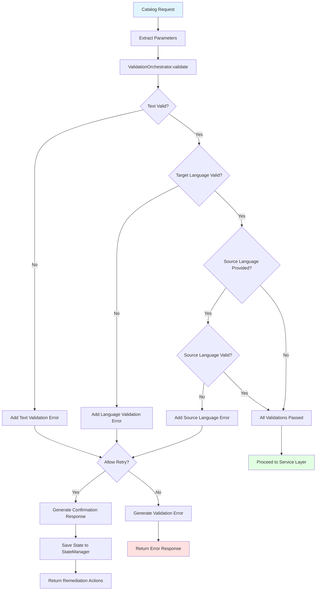

# Google Cloud Translation Extension - Architecture Documentation

## 📋 Table of Contents
1. [Overview](#overview)
2. [Architecture Layers](#architecture-layers)
3. [Component Diagrams](#component-diagrams)
4. [Data Flow](#data-flow)
5. [Performance Limitations](#performance-limitations)
6. [Error Scenarios](#error-scenarios)
7. [Security Considerations](#security-considerations)
8. [Monitoring & Observability](#monitoring--observability)
9. [Future Enhancements](#future-enhancements)
10. [Appendix](#appendix)

---

## 1. Overview

The **Google Cloud Translation Extension** is a Java 21-based integration that provides seamless access to Google Cloud's Translation API v3. It enables language detection, text translation, and language support queries using Google's Neural Machine Translation (NMT) model.

### Key Features
- ✅ **Text Translation**: Translate text between 100+ languages
- ✅ **Language Detection**: Automatically detect the language of input text
- ✅ **Supported Languages**: Query all languages supported by Google Translate
- ✅ **Auto-Detection**: Optional source language auto-detection
- ✅ **Error Handling**: Comprehensive validation and remediation flows
- ✅ **Telemetry**: Built-in monitoring and performance tracking
- ✅ **File Support**: Service account credentials via file upload

### Technology Stack
- **Java Version**: Java 21
- **Build Tool**: Gradle
- **Framework**: Krista Extension Framework
- **Dependency Injection**: HK2
- **External API**: Google Cloud Translation API v3
- **Authentication**: Service Account JSON credentials
- **Google Client Library**: `google-cloud-translate` v2.x
- **Testing**: JUnit 5, Mockito

### Supported Operations
| Operation | Description | Max Input |
|-----------|-------------|-----------|
| **Translate To Language** | Translate text between languages | 30,000 chars |
| **Detect Language** | Identify the language of text | 30,000 chars |
| **Get Supported Languages** | List all supported languages | N/A |

---

## 2. Architecture Layers

The extension follows a **6-layer architecture** pattern with clear separation of concerns:

### 2.1 Presentation Layer (Catalog)
**Location**: `com.kristasoft.extensions.ai.nlp.gcp.catalog`

**Components**:
- **TranslationArea**: Main catalog area exposing 3 catalog requests
  - `translateToLanguage()` - Translate text to target language
  - `detectLanguage()` - Detect language of input text
  - `getSupportedLanguages()` - Get list of supported languages

**Responsibilities**:
- Request parameter reception
- Delegation to facade layer
- Response formatting
- Logging catalog request entry points

### 2.2 Facade Layer
**Location**: `com.kristasoft.extensions.ai.nlp.gcp.catalog.service`

**Components**:
- **TranslationOperationsFacade**: Thin routing layer
  - Routes catalog requests to response service
  - Provides abstraction between presentation and business logic
  - Centralizes operation logging

**Responsibilities**:
- Request routing
- Operation-level logging
- Abstraction layer for future extensibility

### 2.3 Service Layer
**Location**: `com.kristasoft.extensions.ai.nlp.gcp.catalog.service`

**Components**:
- **TranslationResponseService**: Core business logic orchestrator
  - Validation orchestration
  - GCP client interaction
  - Response generation
  - Error handling
  - Telemetry tracking

**Responsibilities**:
- Business logic execution
- Validation coordination
- API interaction
- Success/error response generation
- Performance tracking

### 2.4 Client Layer
**Location**: `com.kristasoft.extensions.ai.nlp.gcp.catalog.client`

**Components**:
- **GcpTranslateClient**: Google Cloud Translation API client wrapper
  - Lazy initialization of TranslationServiceClient
  - Credential management
  - API method wrappers (translate, detect, getSupportedLanguages)
  - Language code/display name conversion
  - Project ID extraction from credentials

**Key Methods**:
```java
public String translateText(String sourceLanguage, String targetLanguage, String text)
public String detect(String text)
public List<String> getSupportedLanguages()
```

**Responsibilities**:
- Google Cloud API interaction
- Credential handling
- Request/response transformation
- Language code mapping
- Connection management

### 2.5 Validation Layer
**Location**: `com.kristasoft.extensions.ai.nlp.gcp.catalog.validators`

**Components**:
- **ValidationOrchestrator**: Coordinates validation across validators
- **TextInputValidator**: Validates text input (length, null checks)
- **LanguageValidator**: Validates language codes/names against supported languages
- **Validator** (Interface): Base validator contract

**Validation Rules**:
- Text input: Max 30,000 characters, not null/empty
- Language: Must be in supported languages list
- Target language: Required for translation

**Responsibilities**:
- Input validation
- Business rule enforcement
- Validation result aggregation
- Error message generation

### 2.6 Cross-Cutting Concerns

#### Error Handling Layer
**Location**: `com.kristasoft.extensions.ai.nlp.gcp.catalog.errorhandlers`

**Components**:
- **ExtensionResponseGenerator**: Generates standardized responses
  - Success responses
  - Validation error responses
  - Confirmation responses for retry
  - Fetch responses for missing data

#### State Management
**Location**: `com.kristasoft.extensions.ai.nlp.gcp.catalog.state`

**Components**:
- **InternalStateManager**: Manages validation and error states
  - Stores validation results
  - Manages remediation context
  - Uses KeyValueStore for persistence

#### Reentry Handling
**Location**: `com.kristasoft.extensions.ai.nlp.gcp.catalog.reentry`

**Components**:
- **ReentryHandlerFactory**: Creates reentry handlers
- **TranslationReentryHandler**: Handles user reentry after validation failures

#### Telemetry Layer
**Location**: `com.kristasoft.extensions.ai.nlp.gcp.catalog.telemetry`

**Components**:
- **TelemetryHelper**: Records metrics and performance data
  - Success/failure counters
  - Duration tracking
  - Validation failure tracking
  - Error tracking

#### Utility Layer
**Location**: `com.kristasoft.extensions.ai.nlp.gcp.catalog.util`

**Components**:
- **Constants**: Application constants
- **ValidationMapHelper**: Validation parameter mapping
- **TelemetryTagsHelper**: Telemetry tag generation
- **SubCatalogConstants**: Sub-catalog constants

#### Media Handling
**Location**: `com.kristasoft.extensions.ai.nlp.gcp.util.media`

**Components**:
- **FileHandlerFactory**: Creates appropriate file handlers
- **KristaFileHandler**: Handles Krista File objects
- **JavaFileHandleHelper**: Handles Java File objects
- **FileHandler** (Interface): File handling contract

---

## 3. Component Diagrams

### 3.1 High-Level Architecture




### 3.2 Translation Flow Sequence Diagram



### 3.3 Language Detection Flow



---

## 4. Data Flow

### 4.1 Translation Request Flow



### 4.2 Language Detection Flow



### 4.3 Credential Initialization Flow



### 4.4 Validation & Remediation Flow



---

## 5. Performance Limitations

### 5.1 Google Cloud Translation API Quotas

Google Cloud enforces **quota limits** on Translation API usage:

| Quota Type | Default Limit | Time Window | Impact |
|------------|---------------|-------------|---------|
| **Characters per minute** | 10,000,000 | 1 minute | Per project |
| **Characters per day** | Unlimited | 24 hours | Based on billing |
| **Requests per minute** | 1,000 | 1 minute | Per project |
| **Requests per 100 seconds** | 1,000 | 100 seconds | Per project |

**Quota Exceeded Response**:
- HTTP Status: `429 Too Many Requests` or `RESOURCE_EXHAUSTED`
- Error: `Quota exceeded for quota metric 'Translate requests'`
- Recommended Action: Exponential backoff and retry

**Extension Handling**:
- ❌ No automatic retry mechanism
- ❌ No quota monitoring
- ❌ No request throttling
- ⚠️ Manual retry required

### 5.2 Input Size Limitations

**Text Input Constraints**:
- **Maximum Characters**: 30,000 per request
- **Validation**: Enforced by TextInputValidator
- **API Limit**: Google Cloud supports up to 30,000 characters

**Character Count Handling**:
```java
if (text.length() > 30000) {
    return ValidationResult.error("Text exceeds maximum length of 30,000 characters");
}
```

**Impact**:
| Input Size | Processing Time | Memory Usage | Risk |
|------------|----------------|--------------|------|
| < 1,000 chars | 200-500ms | < 1 MB | Low |
| 1,000-10,000 chars | 500-1500ms | 1-5 MB | Low |
| 10,000-30,000 chars | 1500-3000ms | 5-15 MB | Medium |
| > 30,000 chars | Rejected | N/A | Validation Error |

### 5.3 Network Latency & Timeouts

**Google Cloud API Latency**:
- **Translation Request**: 200-2000ms (varies by text length)
- **Language Detection**: 150-800ms
- **Get Supported Languages**: 100-500ms (cached after first call)

**Latency Factors**:
- Text length
- Source/target language pair
- Network round-trip time: 50-300ms
- TLS handshake: 100-200ms (first request)
- API processing time

**Timeout Configuration**:
- ❌ No explicit timeout configured
- Uses Google Cloud client library defaults
- Default timeout: ~60 seconds

### 5.4 Memory Constraints

**Client Initialization**:
- **TranslationServiceClient**: ~10-20 MB
- **Supported Languages Cache**: ~500 KB (100+ languages)
- **Credentials**: ~5-10 KB

**Per-Request Memory**:
| Operation | Typical Memory | Peak Memory | Notes |
|-----------|---------------|-------------|-------|
| Translate (1K chars) | 500 KB | 2 MB | Includes request/response |
| Translate (30K chars) | 2 MB | 10 MB | Maximum input size |
| Detect Language | 300 KB | 1 MB | Minimal overhead |
| Get Supported Languages | 100 KB | 500 KB | Cached after first call |

**Lazy Initialization**:
- Client initialized on first use
- Reduces startup memory footprint
- ✅ Efficient resource usage

### 5.5 Concurrent Request Limitations

**Google Cloud Client**:
- Uses gRPC for communication
- Connection pooling managed by client library
- Default: Multiple concurrent requests supported

**Extension Constraints**:
- ❌ No explicit concurrency control
- ❌ No request queuing
- ❌ No connection pool configuration
- ⚠️ Relies on Google Cloud client defaults

---

## 6. Error Scenarios

### 6.1 Validation Errors

#### 6.1.1 Empty or Null Text Input
**Scenario**: User provides empty, null, or whitespace-only text

**Detection**:
```java
if (text == null || text.isBlank()) {
    return ValidationResult.error("Text input is required and cannot be empty");
}
```

**Response**:
```json
{
  "error": {
    "message": "Text input is required and cannot be empty",
    "type": "INPUT_ERROR",
    "actions": [
      {
        "type": "ASK",
        "field": "Text"
      }
    ]
  }
}
```

**User Experience**:
- If `allowRetry = true`: User prompted to enter text
- If `allowRetry = false`: Error returned immediately

#### 6.1.2 Text Exceeds Maximum Length
**Scenario**: User provides text longer than 30,000 characters

**Detection**:
```java
if (text.length() > 30000) {
    return ValidationResult.error("Text exceeds maximum length of 30,000 characters");
}
```

**Response**: Validation error with character count

**Mitigation**: User must reduce text length

#### 6.1.3 Invalid Target Language
**Scenario**: User provides unsupported or invalid target language

**Detection**:
- LanguageValidator checks against supported languages list
- Case-insensitive comparison

**Response**:
```json
{
  "error": {
    "message": "Target language 'XYZ' is not supported",
    "type": "INPUT_ERROR",
    "actions": [
      {
        "type": "FETCH",
        "field": "Target Language",
        "fetchRequest": "getSupportedLanguages"
      }
    ]
  }
}
```

**User Experience**: Prompted to select from supported languages

#### 6.1.4 Invalid Source Language
**Scenario**: User provides invalid source language (when specified)

**Detection**: Same as target language validation

**Response**: Fetch action to select valid source language

**Note**: Source language is optional; if not provided, auto-detection is used

### 6.2 Authentication Errors

#### 6.2.1 Invalid Service Account Credentials
**Scenario**: Incorrect or malformed service account JSON

**Detection**:
```java
try {
    GoogleCredentials.fromStream(new FileInputStream(serviceAccountCredentials))
} catch (IOException e) {
    throw new IllegalArgumentException("Invalid service account credentials");
}
```

**Error Message**: "Please enter valid credentials"

**Extension Handling**:
- Validation fails during `validateAttributes()`
- Extension initialization blocked
- User must provide valid credentials

#### 6.2.2 Insufficient Permissions
**Scenario**: Service account lacks Translation API permissions

**Google Cloud Error**:
```
PERMISSION_DENIED: The caller does not have permission
```

**Extension Handling**:
- Exception thrown during API call
- Wrapped in RuntimeException
- User sees generic error message

**Required Permissions**:
- `cloudtranslate.translations.translate`
- `cloudtranslate.languages.list`
- `cloudtranslate.languages.detect`

#### 6.2.3 API Not Enabled
**Scenario**: Translation API not enabled in GCP project

**Google Cloud Error**:
```
FAILED_PRECONDITION: Cloud Translation API has not been used in project
```

**Extension Handling**: Exception propagated to user

**Resolution**: Enable Translation API in GCP Console

### 6.3 Network Errors

#### 6.3.1 Connection Timeout
**Scenario**: Network connectivity issues or slow API response

**Exception**:
```java
io.grpc.StatusRuntimeException: DEADLINE_EXCEEDED
```

**Extension Handling**:
- Exception thrown from GcpTranslateClient
- Wrapped in RuntimeException
- No automatic retry

**Mitigation**:
- ❌ No timeout configuration
- ⚠️ User must manually retry

#### 6.3.2 Network Unavailable
**Scenario**: No internet connectivity

**Exception**:
```java
io.grpc.StatusRuntimeException: UNAVAILABLE: io exception
```

**Extension Handling**: Exception propagated to user

**User Action**: Check network connectivity and retry

### 6.4 Google Cloud API Errors

#### 6.4.1 Quota Exceeded (429)
**Scenario**: Project quota limits exceeded

**Google Cloud Error**:
```
RESOURCE_EXHAUSTED: Quota exceeded for quota metric 'Translate requests'
```

**Extension Handling**:
- Exception thrown
- ❌ No automatic retry
- ❌ No quota monitoring

**Recommended Enhancement**:
```java
if (error.getCode() == StatusCode.Code.RESOURCE_EXHAUSTED) {
    // Implement exponential backoff
    Thread.sleep(calculateBackoff(attempt));
    retry();
}
```

#### 6.4.2 Invalid Request (400)
**Scenario**: Malformed API request

**Google Cloud Error**:
```
INVALID_ARGUMENT: Invalid language code
```

**Extension Handling**:
- Should be prevented by validation
- If occurs, exception propagated to user

**Common Causes**:
- Invalid language code format
- Unsupported language pair
- Malformed text encoding

#### 6.4.3 Service Unavailable (503)
**Scenario**: Google Cloud service temporarily unavailable

**Google Cloud Error**:
```
UNAVAILABLE: The service is currently unavailable
```

**Extension Handling**:
- Exception thrown
- ❌ No automatic retry
- User must retry manually

### 6.5 Business Logic Errors

#### 6.5.1 Empty Supported Languages List
**Scenario**: Failed to load supported languages during initialization

**Detection**:
```java
if (supportedLanguagelist.isEmpty()) {
    throw new IllegalArgumentException("Please enter valid credentials");
}
```

**Extension Handling**:
- Validation fails
- Extension initialization blocked

**Causes**:
- Invalid credentials
- API not enabled
- Network issues during initialization

#### 6.5.2 Language Code Mapping Failure
**Scenario**: Display name to language code conversion fails

**Detection**: Language not found in supported languages cache

**Extension Handling**:
- Returns null or empty string
- May cause API error

**Mitigation**: Validation should prevent this scenario

### 6.6 File Handling Errors

#### 6.6.1 Invalid Service Account File
**Scenario**: Uploaded file is not valid JSON

**Detection**:
```java
try {
    getProjectId(new FileInputStream(jsonCredentials));
} catch (Exception e) {
    throw new IllegalArgumentException("Invalid service account file format");
}
```

**Extension Handling**: Validation fails

**User Action**: Upload valid service account JSON file

#### 6.6.2 Missing Project ID
**Scenario**: Service account JSON missing project_id field

**Detection**: Project ID extraction fails

**Extension Handling**: Exception during initialization

**Resolution**: Use valid service account JSON with project_id

---

## 7. Security Considerations

### 7.1 Authentication & Authorization

**Authentication Method**: Service Account JSON
- Google Cloud service account credentials
- OAuth 2.0 with JWT
- Scoped to `https://www.googleapis.com/auth/cloud-platform`

**Credential Management**:
- ✅ Stored as secured file field (`@File`)
- ✅ Not logged in plain text
- ✅ Encrypted by Krista platform
- ⚠️ Stored in memory during runtime

**Authorization**:
- Google Cloud IAM enforces permissions
- Extension respects GCP RBAC
- No additional authorization layer

**Required IAM Roles**:
- `roles/cloudtranslate.user` (Cloud Translation API User)
- Or custom role with specific permissions

### 7.2 Data Protection

**Data in Transit**:
- ✅ HTTPS/TLS enforced by Google Cloud client
- ✅ gRPC with TLS 1.2+
- ✅ Certificate validation enabled

**Data at Rest**:
- Extension stores minimal data
- Supported languages cached in memory
- ❌ No encryption for cached data
- ⚠️ Text content in memory during processing

**Sensitive Data Handling**:
- Service account credentials: Secured file field
- Translation text: Processed in memory, not persisted
- API responses: Not cached or stored

### 7.3 Input Validation & Sanitization

**Validation Layers**:
1. **Field-level validation**: Required fields, data types
2. **Business validation**: Text length, language support
3. **API validation**: Google Cloud validates request

**Sanitization**:
- ❌ No explicit HTML sanitization
- ⚠️ Relies on Google Cloud API for content validation
- Text passed as-is to API

**Injection Prevention**:
- ✅ Uses Google Cloud client library (prevents injection)
- ✅ No SQL or command injection risk
- ❌ No XSS prevention (not applicable for translation)

### 7.4 API Security

**Credential Exposure Risks**:
- ✅ Not logged in plain text
- ✅ Not exposed in error messages
- ⚠️ Visible in memory dumps
- ⚠️ Stored in file system temporarily

**Request Security**:
- ✅ HTTPS/gRPC with TLS
- ✅ OAuth 2.0 authentication
- ✅ Scoped credentials
- ❌ No request signing (handled by Google Cloud)

**Response Validation**:
- ✅ Type-safe response parsing
- ✅ Exception handling for malformed responses
- ❌ No response signature verification

### 7.5 Compliance & Privacy

**GDPR Considerations**:
- ⚠️ Translation text may contain PII
- ⚠️ Text sent to Google Cloud (third-party processing)
- ❌ No data retention policy
- ❌ No data deletion mechanism

**Data Residency**:
- Depends on Google Cloud region configuration
- Extension does not control data location
- Uses global endpoint by default

**Audit Logging**:
- ✅ All operations logged with timestamps
- ✅ Success/failure logged
- ⚠️ Text length logged (not content)
- ❌ No centralized audit trail

---

## 8. Monitoring & Observability

### 8.1 Telemetry Metrics

**TelemetryHelper** tracks the following metrics:

#### Success Metrics
```java
telemetryHelper.recordSuccess(
    "gcp.translate.translateToLanguage",
    startTime,
    Map.of("source", sourceLanguage, "target", targetLanguage, "textLength", textLength)
);
```

**Tracked Operations**:
- `gcp.translate.translateToLanguage`
- `gcp.translate.detectLanguage`
- `gcp.translate.getSupportedLanguages`

**Metrics Collected**:
- **Count**: Number of successful operations
- **Duration**: Time taken (ms)
- **Tags**: Operation-specific metadata (languages, text length)

#### Error Metrics
```java
telemetryHelper.recordError(
    "gcp.translate.translateToLanguage",
    startTime,
    exception,
    Map.of("source", sourceLanguage, "target", targetLanguage, "errorType", "API_ERROR")
);
```

**Error Categories**:
- Validation errors
- Authentication errors
- Network errors
- API errors (quota, permission, service unavailable)

#### Validation Metrics
```java
telemetryHelper.recordValidationFailure(
    "gcp.translate.translateToLanguage",
    startTime,
    Map.of("validationErrors", errorCount)
);
```

**Validation Tracking**:
- Number of validation failures
- Validation error types
- Retry prompts issued

### 8.2 Logging Strategy

**Log Levels**:
- **INFO**: Operation start, API calls, success, initialization
- **DEBUG**: Validation details, intermediate steps, facade routing
- **WARN**: Validation failures (implicit)
- **ERROR**: Exceptions, API errors, initialization failures

**Key Log Points**:
```java
LOGGER.info("CatalogRequest translateToLanguage start with text length: {}, sourceLanguage: {}, targetLanguage: {}, allowRetry: {}",
    textLength, sourceLanguage, targetLanguage, allowRetry);
LOGGER.debug("Facade: translateToLanguage - text length: {}, source: {}, target: {}, allowRetry: {}",
    textLength, sourceLanguage, targetLanguage, allowRetry);
LOGGER.error("Failed to initialize GcpTranslateClient: {}", e.getMessage(), e);
```

**Structured Logging**:
- Operation name prefix
- Contextual parameters (sanitized)
- Safe string handling (prevents null logging)

**PII Protection**:
- ✅ Text content not logged
- ✅ Only text length logged
- ✅ Language codes logged (not PII)

### 8.3 Health Checks

**Extension Health**:
- `testConnection()`: Validates credentials and connectivity
- `validateAttributes()`: Verifies configuration

**Health Check Flow**:
1. Load service account credentials
2. Create GcpTranslateClient
3. Call `getSupportedLanguages()`
4. Validate non-empty response

**Health Indicators**:
- ✅ Non-empty supported languages: Healthy
- ❌ Empty supported languages: Unhealthy
- ❌ Exception: Configuration error

### 8.4 Performance Monitoring

**Key Performance Indicators (KPIs)**:

| Metric | Target | Warning | Critical |
|--------|--------|---------|----------|
| **Translation Response Time** | < 1s | 1-2s | > 2s |
| **Detection Response Time** | < 500ms | 500ms-1s | > 1s |
| **Success Rate** | > 99% | 95-99% | < 95% |
| **Validation Failure Rate** | < 5% | 5-10% | > 10% |
| **API Error Rate** | < 1% | 1-3% | > 3% |

**Performance Tracking**:
- Duration tracking for all operations
- API call latency
- Validation overhead
- Client initialization time

---

## 9. Future Enhancements

### 9.1 High Priority

#### 9.1.1 Retry Mechanism with Exponential Backoff
**Problem**: No automatic retry for transient failures or quota errors

**Solution**:
```java
@Service
public class RetryExecutor {
    public <T> T executeWithRetry(Supplier<T> operation, RetryConfig config) {
        int attempt = 0;
        while (attempt < config.maxAttempts) {
            try {
                return operation.get();
            } catch (StatusRuntimeException e) {
                if (e.getStatus().getCode() == StatusCode.Code.RESOURCE_EXHAUSTED) {
                    long delay = config.baseDelay * (long) Math.pow(2, attempt);
                    Thread.sleep(Math.min(delay, config.maxDelay));
                    attempt++;
                } else {
                    throw e;
                }
            }
        }
    }
}
```

**Benefits**:
- Handle quota exceeded errors
- Improve reliability for transient failures
- Better user experience

#### 9.1.2 Batch Translation Support
**Problem**: No support for translating multiple texts in one request

**Solution**:
```java
public List<String> translateBatch(List<String> texts, String sourceLanguage, String targetLanguage) {
    TranslateTextRequest request = TranslateTextRequest.newBuilder()
        .setParent(parent.toString())
        .addAllContents(texts)
        .setSourceLanguageCode(sourceLanguage)
        .setTargetLanguageCode(targetLanguage)
        .build();
    // Process batch response
}
```

**Benefits**:
- Reduce API calls
- Improve performance
- Lower costs

#### 9.1.3 Caching for Supported Languages
**Problem**: Supported languages loaded on every client initialization

**Solution**:
```java
@Service
public class LanguageCacheService {
    private static final Cache<String, List<SupportedLanguage>> cache = 
        CacheBuilder.newBuilder()
            .expireAfterWrite(24, TimeUnit.HOURS)
            .build();
    
    public List<SupportedLanguage> getSupportedLanguages(String projectId) {
        return cache.get(projectId, () -> loadFromAPI(projectId));
    }
}
```

**Benefits**:
- Faster initialization
- Reduced API calls
- Lower latency

### 9.2 Medium Priority

#### 9.2.1 Translation History/Cache
**Problem**: Same text translated multiple times

**Solution**:
```java
@Service
public class TranslationCacheService {
    private final Cache<TranslationKey, String> cache;
    
    public String getOrTranslate(String text, String source, String target) {
        TranslationKey key = new TranslationKey(text, source, target);
        return cache.get(key, () -> gcpClient.translateText(source, target, text));
    }
}
```

**Configuration**:
- TTL: 1 hour
- Max size: 1000 entries
- LRU eviction

**Benefits**:
- Reduce API calls
- Improve response time
- Lower costs

#### 9.2.2 Glossary Support
**Problem**: No support for custom terminology

**Solution**:
- Integrate Google Cloud Translation glossaries
- Allow users to upload custom glossaries
- Apply glossaries to translations

**Benefits**:
- Consistent terminology
- Domain-specific translations
- Better accuracy

#### 9.2.3 Document Translation
**Problem**: Only plain text translation supported

**Solution**:
- Support HTML translation
- Support document formats (DOCX, PDF)
- Preserve formatting

**Benefits**:
- Broader use cases
- Better user experience

### 9.3 Low Priority

#### 9.3.1 Advanced Language Detection
**Problem**: Only single language detection

**Solution**:
- Detect multiple languages in text
- Provide confidence scores
- Detect language regions/dialects

#### 9.3.2 Translation Quality Metrics
**Problem**: No quality assessment

**Solution**:
- Confidence scores
- Alternative translations
- Quality feedback mechanism

#### 9.3.3 Custom Model Support
**Problem**: Only default NMT model used

**Solution**:
- Support AutoML Translation models
- Allow model selection
- Custom model training integration

---

## 10. Appendix

### 10.1 Catalog Request Reference

| Catalog Request | Type | Description | Max Input |
|----------------|------|-------------|-----------|
| `translateToLanguage` | QUERY_SYSTEM | Translate text to target language | 30,000 chars |
| `detectLanguage` | QUERY_SYSTEM | Detect language of text | 30,000 chars |
| `getSupportedLanguages` | QUERY_SYSTEM | List all supported languages | N/A |

### 10.2 Validator Reference

| Validator | Resource | Validation Method | Error Message |
|-----------|----------|-------------------|---------------|
| `TextInputValidator` | TEXT | Length, null check | "Text input is required" / "Text exceeds maximum length" |
| `LanguageValidator` | LANGUAGE | Supported language check | "Language not supported" |

### 10.3 Google Cloud API Reference

| API Method | Endpoint | Purpose |
|------------|----------|---------|
| `translateText` | `projects/{project}/locations/global:translateText` | Translate text |
| `detectLanguage` | `projects/{project}/locations/global:detectLanguage` | Detect language |
| `getSupportedLanguages` | `projects/{project}/locations/global/supportedLanguages` | List languages |

### 10.4 Error Code Reference

| Error Code | Meaning | Extension Handling |
|------------|---------|-------------------|
| `INVALID_ARGUMENT` | Bad request | Validation should prevent |
| `PERMISSION_DENIED` | Insufficient permissions | Exception to user |
| `RESOURCE_EXHAUSTED` | Quota exceeded | Exception (no retry) |
| `UNAVAILABLE` | Service unavailable | Exception (no retry) |
| `DEADLINE_EXCEEDED` | Timeout | Exception (no retry) |
| `FAILED_PRECONDITION` | API not enabled | Exception to user |

### 10.5 Supported Languages (Sample)

Google Cloud Translation supports 100+ languages including:
- **Major Languages**: English, Spanish, French, German, Chinese, Japanese, Korean, Arabic, Hindi, Portuguese
- **Regional Variants**: en-US, en-GB, zh-CN, zh-TW, pt-BR, pt-PT
- **Less Common**: Afrikaans, Albanian, Amharic, Armenian, Azerbaijani, Basque, Belarusian, Bengali, Bosnian, Bulgarian, Catalan, Cebuano, Chichewa, Corsican, Croatian, Czech, Danish, Dutch, Esperanto, Estonian, Filipino, Finnish, Frisian, Galician, Georgian, Greek, Gujarati, Haitian Creole, Hausa, Hawaiian, Hebrew, Hmong, Hungarian, Icelandic, Igbo, Indonesian, Irish, Italian, Javanese, Kannada, Kazakh, Khmer, Kurdish, Kyrgyz, Lao, Latin, Latvian, Lithuanian, Luxembourgish, Macedonian, Malagasy, Malay, Malayalam, Maltese, Maori, Marathi, Mongolian, Myanmar, Nepali, Norwegian, Pashto, Persian, Polish, Punjabi, Romanian, Russian, Samoan, Scots Gaelic, Serbian, Sesotho, Shona, Sindhi, Sinhala, Slovak, Slovenian, Somali, Sundanese, Swahili, Swedish, Tajik, Tamil, Telugu, Thai, Turkish, Ukrainian, Urdu, Uzbek, Vietnamese, Welsh, Xhosa, Yiddish, Yoruba, Zulu

### 10.6 Glossary

| Term | Definition |
|------|------------|
| **Catalog Request** | Extension operation exposed to Krista platform |
| **Catalog Area** | Logical grouping of related catalog requests |
| **Extension Response** | Standardized response format for catalog requests |
| **Validation Orchestrator** | Coordinates validation across multiple validators |
| **Internal State Manager** | Manages validation and error states for remediation |
| **Telemetry Helper** | Records metrics and performance data |
| **Google Cloud Translation API** | Google's machine translation service |
| **Service Account** | GCP authentication mechanism for applications |
| **NMT** | Neural Machine Translation - Google's ML-based translation |
| **Language Code** | ISO 639-1 code (e.g., "en", "es", "fr") |
| **Display Name** | Human-readable language name (e.g., "English", "Spanish") |
| **Project ID** | Google Cloud project identifier |

---

## Document Information

**Version**: 1.0  
**Last Updated**: 2025-10-31  
**Extension Version**: 2.0.4  
**Author**: Architecture Documentation Generator  
**Status**: Complete

---

**End of Architecture Documentation**
