# Creating GCP Service Account

## Overview

This guide provides step-by-step instructions for creating a Google Cloud Platform (GCP) project, enabling the Cloud
Translation API, creating a service account, and downloading the credentials needed for the GCP Translate Extension.

## Prerequisites

Before you begin, ensure you have:

- A Google account
- Access to Google Cloud Console
- Billing enabled on your Google Cloud account (required for API usage)
- Appropriate permissions to create projects and service accounts

## Step-by-Step Instructions

### Step 1: Create a Google Cloud Project

1. Navigate to Google Cloud Console
    - Go to [https://console.cloud.google.com](https://console.cloud.google.com)
    - Sign in with your Google account

   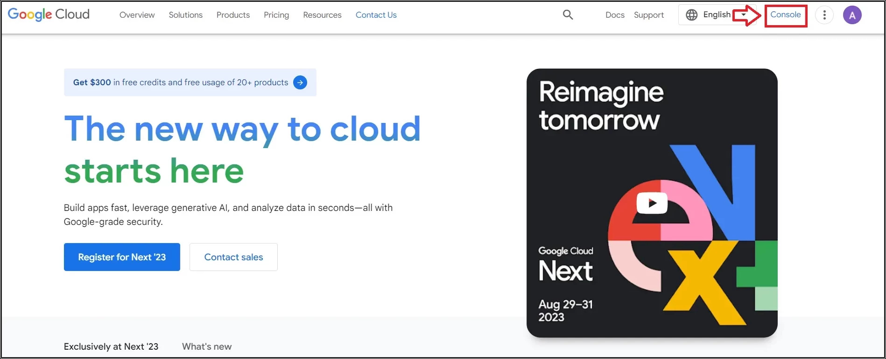

2. Create a New Project
    - Click the project dropdown at the top of the page
    - Click "New Project"

   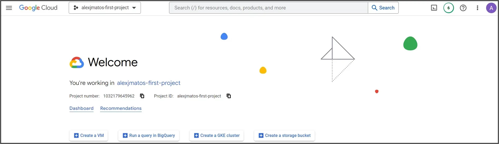

    - Enter a project name (e.g., "krista-translate-extension")
    - Select a billing account (required)
    - Choose an organization (if applicable)

   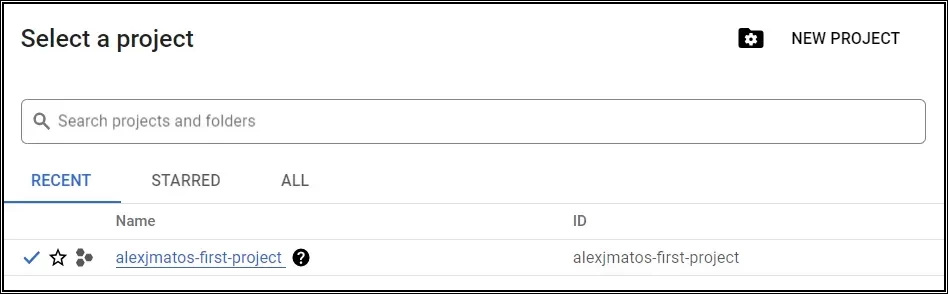

   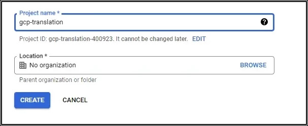

    - Click "Create"

3. Wait for Project Creation
    - Project creation takes a few seconds
    - You'll see a notification when complete
    - The new project will be automatically selected

   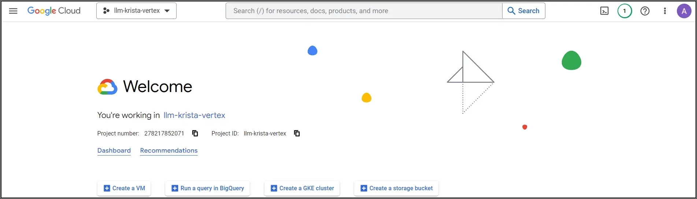

### Step 2: Enable Cloud Translation API

1. Navigate to APIs & Services
    - From the navigation menu (hamburger icon), select "APIs & Services"
    - Click "Library"

   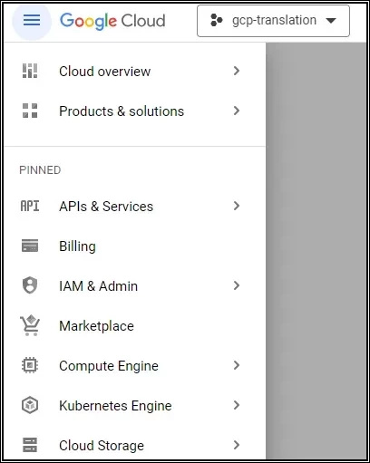

2. Search for Translation API
    - In the search box, type "Cloud Translation API"
    - Click on "Cloud Translation API" from the results

   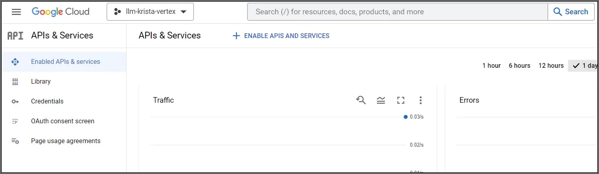

3. Enable the API
    - Click the "Enable" button
    - Wait for the API to be enabled (takes 1-2 minutes)
    - You'll see a confirmation message when complete

   

4. Verify API is Enabled
    - Navigate to "APIs & Services" > "Enabled APIs & services"
    - Confirm "Cloud Translation API" appears in the list

### Step 3: Create a Service Account

1. Navigate to Service Accounts
    - From the navigation menu, select "IAM & Admin"
    - Click "Service Accounts"

   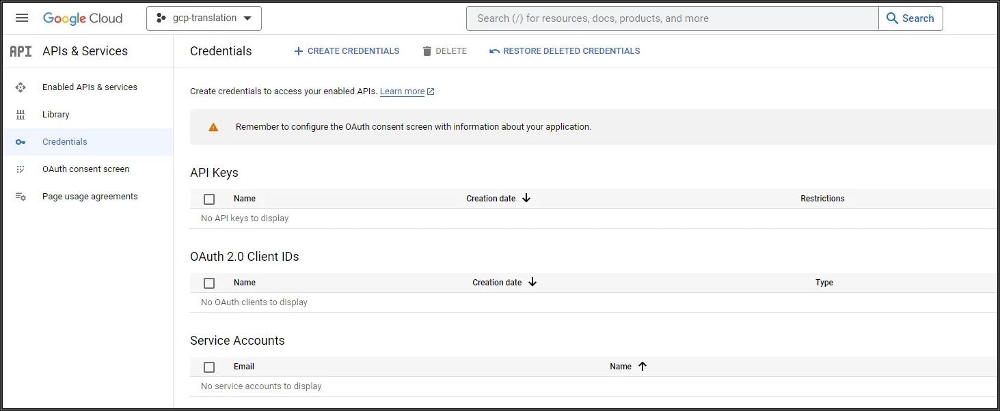

2. Create Service Account
    - Click "+ CREATE SERVICE ACCOUNT" at the top

   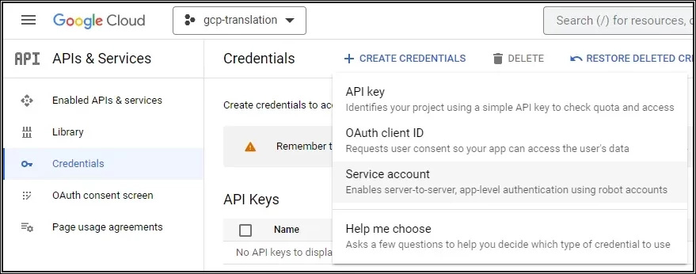

    - Enter service account details:
        - Service account name: "krista-translate-service"
        - Service account ID: (auto-generated, e.g., "krista-translate-service")
        - Description: "Service account for Krista GCP Translate Extension"

   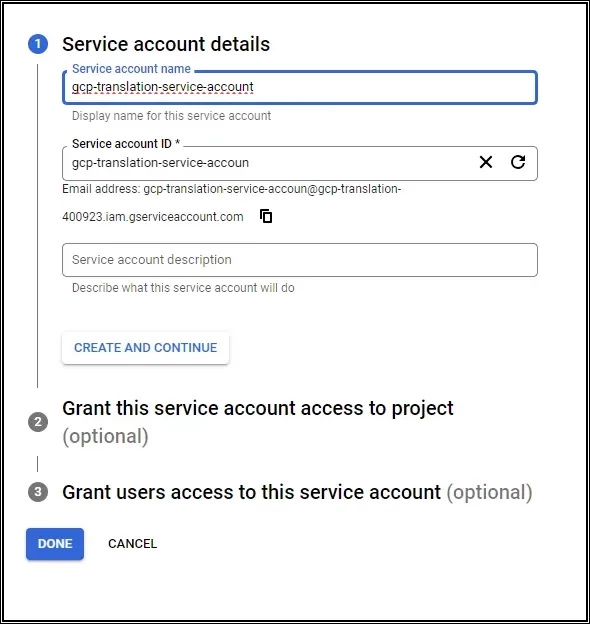

    - Click "CREATE AND CONTINUE"

3. Grant Permissions
    - In the "Grant this service account access to project" section
    - Click "Select a role" dropdown
    - Search for "Cloud Translation API User"
    - Select "Cloud Translation API User"

   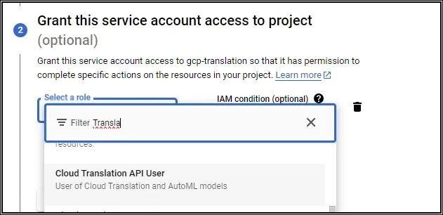

    - Click "CONTINUE"

4. Grant User Access (Optional)
    - This step is optional for basic setup
    - Click "DONE" to skip

   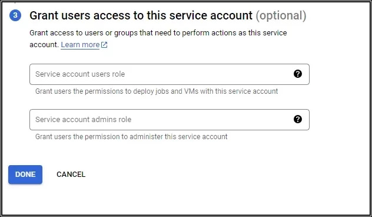

5. Verify Service Account Creation
    - You should see your new service account in the list
    - Note the email address (e.g., krista-translate-service@project-id.iam.gserviceaccount.com)

### Step 4: Create and Download Service Account Key

1. Access Service Account Keys
    - In the Service Accounts list, find your newly created service account
    - Click on the service account email to open details
    - Navigate to the "KEYS" tab

   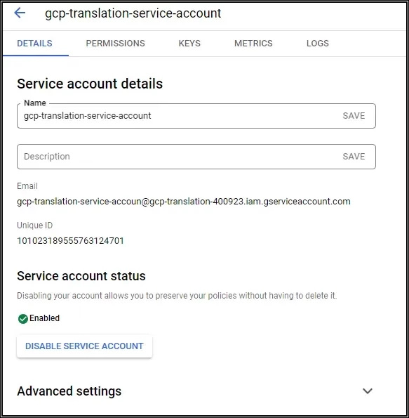

2. Create New Key
    - Click "ADD KEY" dropdown
    - Select "Create new key"

   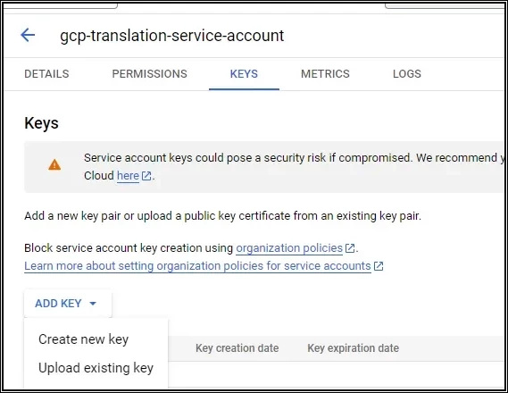

3. Choose Key Type
    - Select "JSON" as the key type
    - Click "CREATE"

   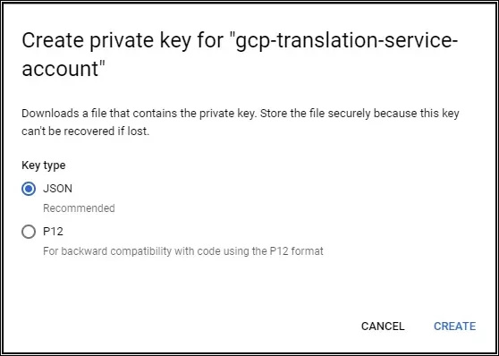

4. Download Key File
    - The JSON key file will automatically download to your computer
    - The file name will be in format: `project-name-xxxxx-xxxxxxxxxx.json`
    - Store this file securely - it contains sensitive credentials

   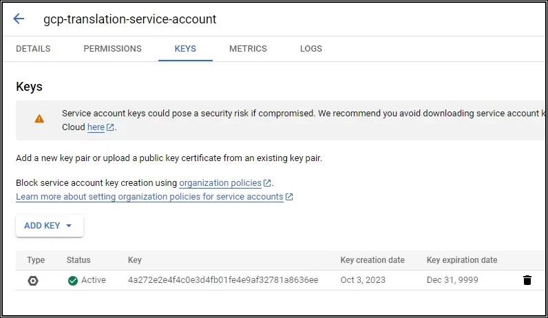

5. Important Security Note
    - This is the only time you can download this key
    - Keep the file secure and never commit it to version control
    - If lost, you'll need to create a new key

### Step 5: Verify Service Account Permissions

1. Navigate to IAM
    - From the navigation menu, select "IAM & Admin" > "IAM"

2. Find Your Service Account
    - Locate your service account in the members list
    - Verify it has the "Cloud Translation API User" role

3. Verify Permissions
    - Click on the service account row to expand details
    - Confirm the following permissions are granted:
        - `cloudtranslate.translations.translate`
        - `cloudtranslate.languages.list`
        - `cloudtranslate.detections.detect`

### Step 6: Test the Service Account (Optional)

You can test the service account using the gcloud CLI:

1. Install Google Cloud SDK (if not already installed)
    - Download from [https://cloud.google.com/sdk/docs/install](https://cloud.google.com/sdk/docs/install)

2. Authenticate with Service Account
   ```bash
   gcloud auth activate-service-account --key-file=path/to/your-key-file.json
   ```

3. Test Translation API Access
   ```bash
   gcloud ml translate detect-language "Hello, world!" --project=your-project-id
   ```

4. If successful, you'll see the detected language (English)

## Verification Checklist

Before proceeding to configure the extension, verify:

- [ ] Google Cloud project created
- [ ] Cloud Translation API enabled
- [ ] Service account created with descriptive name
- [ ] Service account has "Cloud Translation API User" role
- [ ] JSON key file downloaded and stored securely
- [ ] Service account email noted for reference
- [ ] Project ID noted for reference

## Security Best Practices

### Protect Your Credentials

1. Never Commit to Version Control
    - Add `*.json` to your `.gitignore` file
    - Never share the key file publicly
    - Don't include in screenshots or documentation

2. Secure Storage
    - Store the JSON file in a secure location
    - Limit file system permissions
    - Use encryption for sensitive storage

3. Access Control
    - Limit who has access to the key file
    - Document who has access
    - Rotate keys regularly (every 90 days recommended)

### Monitor Usage

1. Enable Audit Logging
    - Navigate to "IAM & Admin" > "Audit Logs"
    - Enable logging for Cloud Translation API
    - Review logs regularly for unusual activity

2. Set Up Billing Alerts
    - Navigate to "Billing" > "Budgets & alerts"
    - Create a budget for Translation API usage
    - Set alert thresholds (e.g., 50%, 90%, 100%)

3. Monitor API Usage
    - Navigate to "APIs & Services" > "Dashboard"
    - Review Cloud Translation API usage metrics
    - Track requests, errors, and latency

## Troubleshooting

### Cannot Create Project

Issue: "You don't have permission to create projects"

Resolution:

- Contact your Google Cloud organization administrator
- Request project creation permissions
- Or ask administrator to create project for you

### Cannot Enable API

Issue: "Billing must be enabled for this project"

Resolution:

1. Navigate to "Billing" in Google Cloud Console
2. Link a billing account to your project
3. Verify billing is active
4. Retry enabling the API

### Cannot Create Service Account

Issue: "You don't have permission to create service accounts"

Resolution:

- You need "Service Account Admin" role
- Contact your project administrator
- Request necessary permissions

### Key Download Failed

Issue: Key file didn't download

Resolution:

1. Check your browser's download settings
2. Disable popup blockers
3. Try a different browser
4. Create a new key if needed

## Next Steps

After creating and downloading your service account key:

1. Configure the Extension
    - Follow the [Extension Configuration](pages/ExtensionConfiguration.md) guide
    - Upload the JSON key file
    - Verify the configuration

2. Review Authentication
    - Read the [Authentication](pages/Authentication.md) documentation
    - Understand security best practices
    - Learn about permission management

3. Start Using the Extension
    - Try [Get Supported Languages](pages/GetSupportedLanguages.md) to test connectivity
    - Explore [Translate To Language](pages/TranslateToLanguage.md) for translation
    - Use [Detect Language](pages/DetectLanguage.md) for language detection

## Additional Resources

- [Google Cloud Translation API Documentation](https://cloud.google.com/translate/docs)
- [Service Account Best Practices](https://cloud.google.com/iam/docs/best-practices-service-accounts)
- [IAM Roles for Translation API](https://cloud.google.com/translate/docs/access-control)
- [Translation API Pricing](https://cloud.google.com/translate/pricing)

## See Also

- [Extension Configuration](pages/ExtensionConfiguration.md) - Configure the extension with your credentials
- [Authentication](pages/Authentication.md) - Understand authentication and security
- [Get Supported Languages](pages/GetSupportedLanguages.md) - Test your setup

