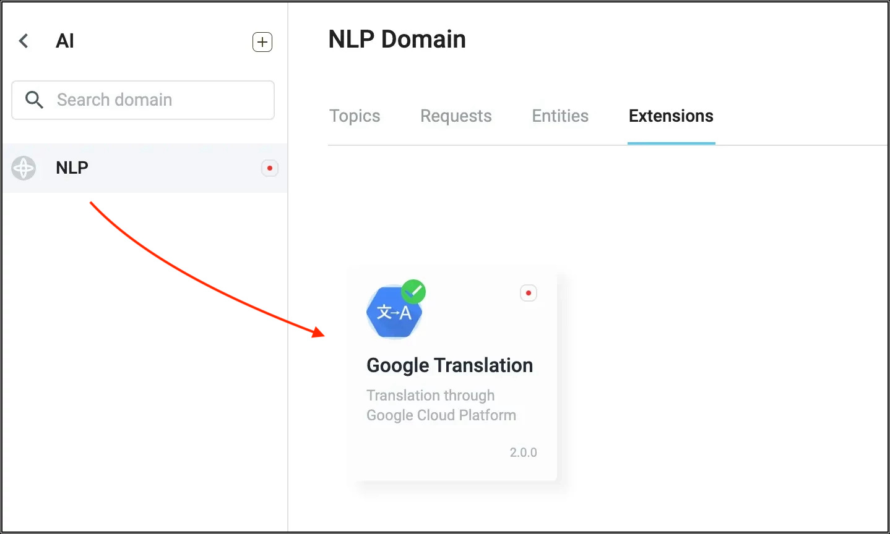
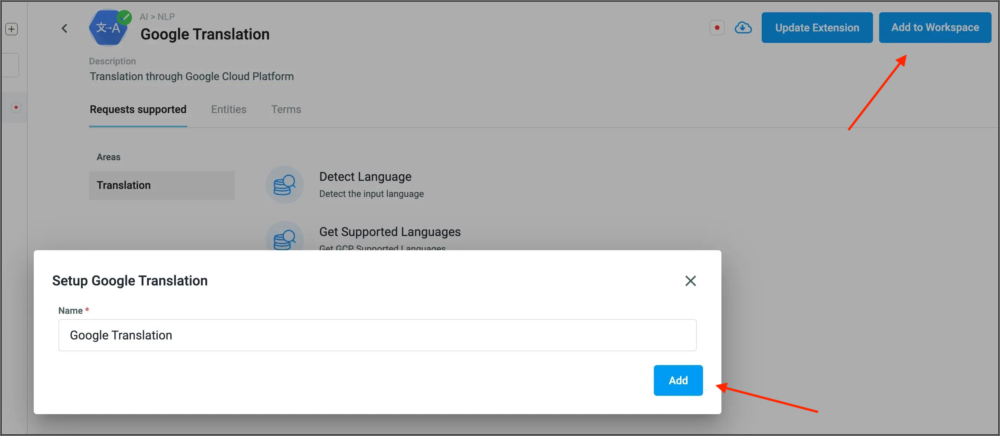
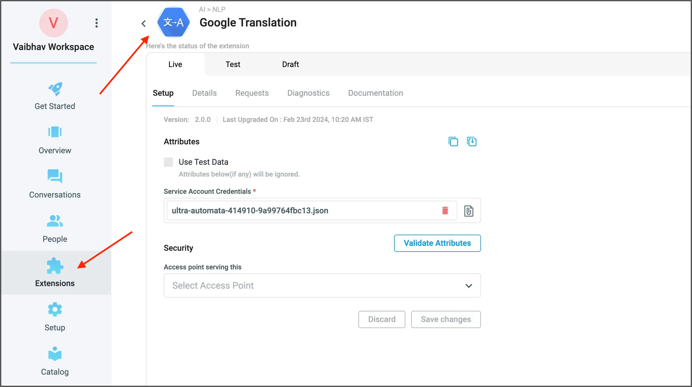
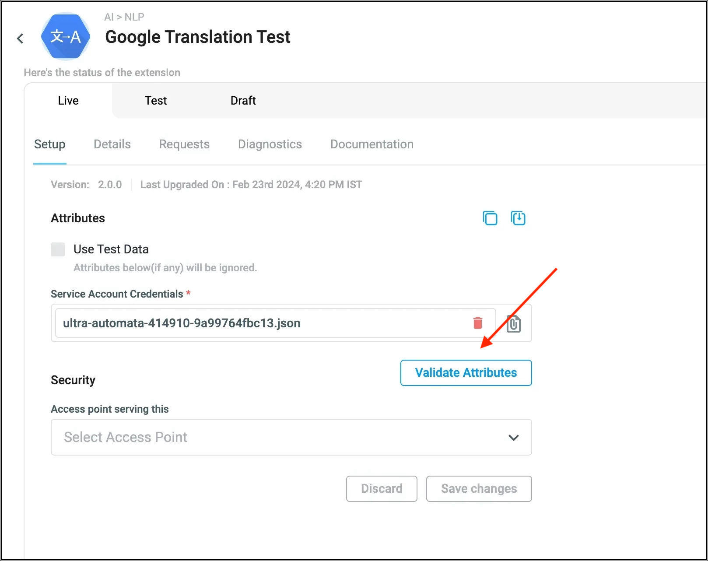
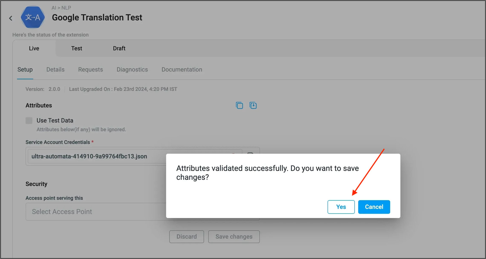
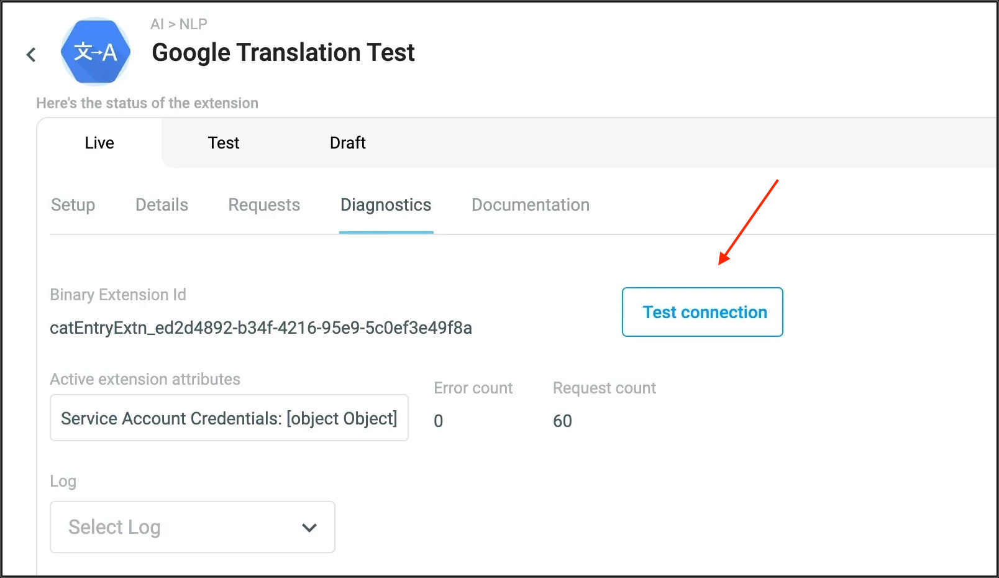

# Extension Configuration

## Overview

The GCP Translate Extension requires configuration with Google Cloud service account credentials to authenticate and
communicate with the Google Cloud Translation API. This page provides detailed instructions for configuring the
extension within the Krista platform.

## Configuration Parameters

| Parameter            | Type | Required | Description                                                  | Example                  |
|----------------------|------|----------|--------------------------------------------------------------|--------------------------|
| Service Account JSON | File | Yes      | Google Cloud service account credentials file in JSON format | service-account-key.json |

## Step-by-Step Setup

### 1. Obtain Service Account Credentials

Before configuring the extension, you must create a service account and download the credentials file:

1. Follow the instructions in [Creating GCP Service Account](pages/CreatingGCPServiceAccount.md)
2. Download the service account JSON key file
3. Store the file securely on your local system

### 2. Access Extension Configuration

1. Log in to the Krista platform
2. Navigate to Catalogs > AI > NLP > Google Cloud Translate
3. Click "Add to Workspace"

   

4. Provide an Extension Name and click "Save"

   

5. Navigate to Extensions > Google Translation
6. Go to the Setup page tab

   

### 3. Upload Service Account Credentials

1. In the Setup page, locate the JSON Credentials File field
2. Click the upload or browse button
3. Select your downloaded service account JSON file
4. The file should be in the format: `project-name-xxxxx-xxxxxxxxxx.json`
5. The credentials will be parsed and displayed (Client Id, Private Key, Token Uri, Email)

   

### 4. Verify Configuration

After uploading the credentials:

1. The extension will validate the credentials file
2. Ensure the file contains valid JSON with required fields:
    - `type`: Should be "service_account"
    - `project_id`: Your GCP project ID
    - `private_key_id`: Service account key ID
    - `private_key`: RSA private key
    - `client_email`: Service account email
    - `client_id`: Service account client ID

3. If validation fails, check the error message and verify:
    - The file is a valid JSON file
    - The service account has not been deleted
    - The project ID is correct

### 5. Validate and Test the Configuration

After uploading credentials:

1. Click "Validate Attributes" and select "Yes" to save the changes

   

2. Click "Test Connection" on the Setup page to verify the connection is established

   

3. Alternatively, use the [Get Supported Languages](pages/GetSupportedLanguages.md) catalog request to verify
   connectivity
4. If successful, you should receive a list of 100+ supported languages

## Authentication Type

The GCP Translate Extension uses Service Account Authentication:

- Authentication Mode: Service Account (Server-to-Server)
- OAuth Flow: Not required (uses service account key)
- User Interaction: None required after initial configuration
- Token Management: Handled automatically by Google Cloud client libraries

### Why Service Account?

Service accounts are ideal for this extension because:

1. Server-to-Server Communication: No user interaction required
2. Consistent Access: Same credentials work for all users
3. Simplified Management: Single set of credentials to manage
4. No Token Expiration: Service account keys don't expire unless revoked
5. Programmatic Access: Designed for application-to-API communication

## Required API Permissions

The service account must have the following permissions:

### Cloud Translation API

- API: Cloud Translation API (translate.googleapis.com)
- Required Role: Cloud Translation API User
- Permissions:
    - `cloudtranslate.translations.translate`
    - `cloudtranslate.languages.list`
    - `cloudtranslate.detections.detect`

### How to Grant Permissions

1. In Google Cloud Console, navigate to IAM & Admin > IAM
2. Find your service account in the list
3. Click Edit (pencil icon)
4. Add role: "Cloud Translation API User"
5. Save changes

## Security Considerations

### Credential Storage

- Never commit credentials to version control: Keep the JSON file out of Git repositories
- Restrict file access: Limit who can access the service account JSON file
- Use secure storage: Store credentials in secure, encrypted storage systems
- Rotate keys regularly: Periodically create new service account keys and delete old ones

### Service Account Security

- Principle of Least Privilege: Grant only the minimum required permissions
- Monitor Usage: Regularly review service account activity in Google Cloud Console
- Enable Audit Logs: Track all API calls made by the service account
- Disable Unused Keys: Delete service account keys that are no longer in use

### Network Security

- Use HTTPS: All communication with Google Cloud APIs uses encrypted HTTPS
- Firewall Rules: Ensure your network allows outbound HTTPS to Google Cloud endpoints
- IP Restrictions: Consider using VPC Service Controls for additional security

## Troubleshooting

### Invalid Credentials Error

Error: "Invalid service account credentials. Please check your credentials file."

Causes:

- Malformed JSON file
- Incorrect file uploaded
- Service account deleted in Google Cloud

Resolution:

1. Verify the JSON file is valid (use a JSON validator)
2. Ensure you uploaded the correct service account key file
3. Check that the service account still exists in Google Cloud Console
4. Download a new key file if necessary

### Missing Project ID Error

Error: "Project ID not found in credentials file."

Causes:

- Incomplete or corrupted JSON file
- Wrong file type uploaded

Resolution:

1. Open the JSON file and verify it contains a `project_id` field
2. Re-download the service account key from Google Cloud Console
3. Ensure you're uploading the service account JSON file, not another type of file

### API Not Enabled Error

Error: "Google Cloud Translation API error: API not enabled"

Causes:

- Translation API not enabled for the project
- Wrong project credentials

Resolution:

1. Go to Google Cloud Console
2. Navigate to APIs & Services > Library
3. Search for "Cloud Translation API"
4. Click Enable
5. Wait a few minutes for the API to be fully enabled

### Permission Denied Error

Error: "Permission denied. Service account lacks required permissions."

Causes:

- Service account missing required IAM roles
- API permissions not granted

Resolution:

1. Go to IAM & Admin > IAM in Google Cloud Console
2. Find your service account
3. Add the "Cloud Translation API User" role
4. Save and wait a few minutes for permissions to propagate

### Network Connection Error

Error: "Network error while connecting to Google Cloud."

Causes:

- Firewall blocking outbound HTTPS
- Network connectivity issues
- Google Cloud service outage

Resolution:

1. Check your internet connection
2. Verify firewall allows HTTPS to *.googleapis.com
3. Check Google Cloud Status Dashboard for service outages
4. Test connectivity: `curl https://translation.googleapis.com`

## Configuration Best Practices

### 1. Use Dedicated Service Accounts

Create a dedicated service account specifically for the Krista GCP Translate Extension rather than reusing existing
service accounts.

### 2. Document Your Configuration

Maintain documentation of:

- Service account email address
- Project ID
- Date credentials were created
- Who has access to credentials

### 3. Test After Configuration

Always test the configuration immediately after setup using the Get Supported Languages request.

### 4. Monitor API Usage

Set up billing alerts and quotas in Google Cloud Console to monitor API usage and costs.

### 5. Plan for Key Rotation

Establish a schedule for rotating service account keys (recommended: every 90 days).

## Next Steps

After configuring the extension:

1. Review [Authentication](pages/Authentication.md) to understand how the extension authenticates with Google Cloud
2. Learn about [Creating GCP Service Account](pages/CreatingGCPServiceAccount.md) for detailed setup instructions
3. Start using the extension with [Translate To Language](pages/TranslateToLanguage.md)

## See Also

- [Authentication](pages/Authentication.md) - Detailed authentication information
- [Creating GCP Service Account](pages/CreatingGCPServiceAccount.md) - Step-by-step service account creation
- [Get Supported Languages](pages/GetSupportedLanguages.md) - Test your configuration

